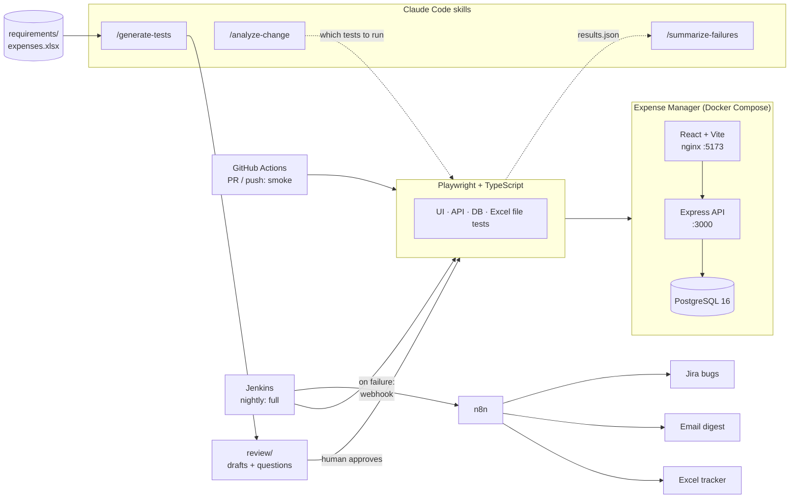
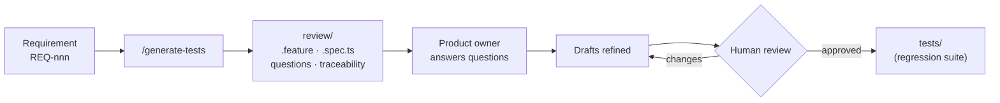

# AI Test Orchestrator

[](https://github.com/jayapriya7297-sketch/AI-testing-orchestrator/actions/workflows/ci.yml)

**AI-assisted test orchestration:** requirements → AI-drafted tests → human review → CI →
failures turned into Jira bugs automatically.

A Playwright + TypeScript framework (UI, API, database and Excel file tests) built around a small
Expense Manager app, with Claude Code skills for test generation and change-impact analysis,
GitHub Actions and a nightly Jenkins run, and an n8n workflow that files the failures in Jira.

## The problem

- Turning requirements into tests by hand is slow, and the link between the two is lost quickly.
- Teams don't know which tests a change actually needs, so they run everything or guess.
- Nightly failures are triaged and filed by hand: late, inconsistently, and often twice.
- AI can draft tests fast, but unreviewed AI output can't be trusted in a regression suite.

## Architecture



- The app and the test runner both run in Docker. CI and Jenkins use the same script
  (`scripts/test-docker.sh`), which starts with a fresh database every time.
- The test runner image version comes from `package-lock.json`, so it always matches the
  installed `@playwright/test`.

## The AI workflow: humans approve everything



1. **Generate.** `/generate-tests` reads a requirement from `requirements/expenses.xlsx` and
   writes drafts to `review/` only:
   - `review/features/<ID>.feature`: Gherkin scenarios
   - `review/specs/<ID>.spec.ts`: Playwright drafts
   - `review/questions/<ID>.md`: ambiguities in the requirement, for the product owner
   - `review/traceability.xlsx`: one row per scenario
2. **Clarify.** The product owner answers the open questions, and the drafts are regenerated from the answers.
3. **Promote.** A person reviews the drafts and moves the approved specs into `tests/`.
   The AI never writes to `tests/` or `app/` on its own.

Example: REQ-002 went from drafts (`76b113d`) to drafts refined from the product owner's
answers (`775bfef`) to tests promoted into the suite (`2ff77fa`).
Drafts can be run on their own with `RUN_REVIEW=1 npx playwright test --project=review`.

## Key features

- **Test layers and tags.** Every test has a layer tag (`@api`, `@ui`, `@db`, `@file`) and
  `@smoke` or `@regression`. DB checks read Postgres directly after API and UI actions.
  Response bodies are checked against ajv schemas.
- **Traceability (RTM).** `review/traceability.xlsx` has one row per scenario (87 rows), linking
  requirement → feature → spec → test title → linked defects.
- **Change-impact analysis (`/analyze-change`).** Changed files are matched to the **Code map**
  in `requirements/expenses.xlsx` (path glob → requirements → risk High/Medium/Low → fallback
  specs). It then finds the affected tests through traceability and prints the overall risk and a
  ready-to-run Playwright command. Shared code (auth, DB, middleware, the test harness) is High risk
  and runs the full suite. Example:
  [docs/examples/change-impact-bug-001.md](docs/examples/change-impact-bug-001.md).
- **Excel report.** `npm run report:excel` turns `reports/results.json` into
  `reports/results.xlsx`, with three sheets: Summary (suite and product pass rate), Results, and
  Known bugs (from the `test.fail()` annotations).
- **Failure triage (`/summarize-failures`).** Classifies each failed test as an app bug, a test
  bug or an environment issue, with evidence. It never changes code. Examples:
  [test bug](docs/examples/failure-summary-test-bug.md),
  [environment](docs/examples/failure-summary-environment.md).
- **Docker test runner.** `npm run test:docker[:smoke]` runs a fresh DB, the full stack and the
  suite plus the Excel report in a Playwright container. The test exit code is kept.
- **n8n failure handling.** For each failure it either comments on the open Jira Bug that has the
  same `at-<id>` label ("Failed again in build #N") or creates a new one, so there are no duplicates.
  When more than 5 tests fail, it files **one** mass-failure Bug instead of dozens. A `test.fail()`
  test that unexpectedly passes becomes a "Known bug may be fixed" Task. Each run also sends an
  email digest and adds a row per failure to an Excel tracker.
- **More skills** for routine work: `/write-api-tests`, `/write-db-tests`, `/write-ui-tests`,
  `/write-file-tests`, `/add-page-object`.

## Quick start

**Prerequisites:** Docker (Docker Desktop on macOS) and Node 26 (see `.nvmrc`; the TypeScript
scripts rely on Node's built-in type stripping).

```sh
cp .env.example .env              # demo values only, no secrets
npm ci
npx playwright install chromium
docker compose up -d --build      # web :5173 · api :3000 · postgres :5432

npm run test:smoke                # @smoke tests
npm test                          # full suite
npm run report                    # Playwright HTML report
npm run report:excel              # reports/results.xlsx
```

Or run everything in Docker as CI does (a fresh DB; this stops your local stack when it's done):

```sh
npm run test:docker:smoke
npm run test:docker
```

Demo logins (seeded, from `.env.example`): `admin@test.com` / `Admin123!` and
`user@test.com` / `User123!`. Open http://localhost:5173.

Nightly Jenkins: [jenkins/README.md](jenkins/README.md). Failure → Jira workflow:
[n8n/README.md](n8n/README.md).

## Results

**Latest full run** (`npm run test:docker`, fresh DB, 2026-10-31):

| Total | Passed | Expected failures | Failed | Flaky | Duration | Suite pass rate | Product pass rate |
|---|---|---|---|---|---|---|---|
| 234 | 230 | 4 | 0 | 0 | 29.5 s | 100% | 98.3% |

| Project | Tests |
|---|---|
| api | 111 |
| db | 49 |
| ui | 73 |
| setup (UI login) | 1 |

The suite has 16 `@smoke` tests (plus setup) and 32 `@file` tests. *Suite* pass rate counts
known bugs pinned with `test.fail()` as expected; *product* pass rate counts only clean passes.

**BUG-001 fix: product pass rate 94.7% → 98.3%**

| | Tests | Passed | Expected failures | Product pass rate |
|---|---|---|---|---|
| Before the fix | 226 | 214 | 12 | 94.7% |
| After the fix | 234 | 230 | 4 | 98.3% |

The fix removed the 8 expected failures that pinned BUG-001 (those tests now pass), and added 8
new admin and ownership tests. The "before" result was the same locally, in Docker, in GitHub
Actions and in the Jenkins nightly.

**Bugs found by the tests** (details: [docs/bugs-found.md](docs/bugs-found.md)):

| ID | Bug | Severity | Status |
|---|---|---|---|
| BUG-001 | Any user could read, edit and delete other users' expenses (BOLA, OWASP API #1) | High | Fixed 2026-10-28 |
| BUG-002 | Non-string title returns "Title is required" instead of "Title must be a string" | Low | Open, pinned by 1 `test.fail()` |
| BUG-003 | Id beyond the integer range returns 500 instead of 404 | Medium | Open, pinned by 3 `test.fail()` |
| BUG-004 | Expense form has no client-side validation | Low | Closed (by design) |
| BUG-005 | The admin sees Edit and Delete on other users' expenses | Low | Open, no test yet |

## Project structure

```
app/                  Expense Manager: api/ (Express), web/ (React + Vite), db/init/ (schema + seed)
tests/                Playwright suite: api/, db/, ui/, auth.setup.ts
pages/                Page objects for the UI tests
fixtures/             API contexts, expense factory + cleanup, xlsx helpers, upload files
schemas/              ajv response schemas
requirements/         expenses.xlsx: requirements REQ-001..010 + Code map
review/               AI drafts awaiting human approval + traceability.xlsx
reporting/            Excel report, CI job summary, n8n payload
scripts/              Docker test runner, change-impact analysis, fixture/requirements builders
.claude/skills/       Claude Code skills (/generate-tests, /analyze-change, ...)
.github/workflows/    GitHub Actions CI
jenkins/ Jenkinsfile  Local nightly Jenkins (+ n8n service)
n8n/                  Failure → Jira workflow, sample payloads, tracker
docs/                 Bugs found, example skill outputs
```

## Limitations and next steps

- **Per-file Code map.** Change impact maps whole files, not functions. One line changed in
  `routes/expenses.js` maps to 7 requirements.
- **Traceability gaps.** The RTM covers REQ-002, 008, 009 and 010. REQ-001 and REQ-003–007
  are tested, but not yet traced scenario by scenario, so `/analyze-change` uses their fallback specs.
  REQ-009 and REQ-010 are planned features, and their drafts are `test.fixme`.
- **No per-test code coverage.** The impact analysis relies on the Code map and traceability, not
  on coverage data.
- **No Jira → requirements sync.** Linked defects in `requirements/expenses.xlsx` are
  updated by hand.
- **Next:** a `generator/` script (Anthropic SDK) to run test generation unattended, still writing
  only to `review/`, plus a UI test for BUG-005.

## Further reading

- [docs/bugs-found.md](docs/bugs-found.md): bug reports with cause, severity and tests
- [docs/examples/](docs/examples/): sample `/analyze-change` and `/summarize-failures` output
- [jenkins/README.md](jenkins/README.md): local nightly Jenkins
- [n8n/README.md](n8n/README.md): failure → Jira, email and Excel tracker
- [tests/CLAUDE.md](tests/CLAUDE.md): test rules (tags, data, failures)
- [CLAUDE.md](CLAUDE.md): conventions for AI-assisted work

## About

Built by Jayapriya, QA Engineer, as a portfolio project exploring AI-assisted testing with human review.
